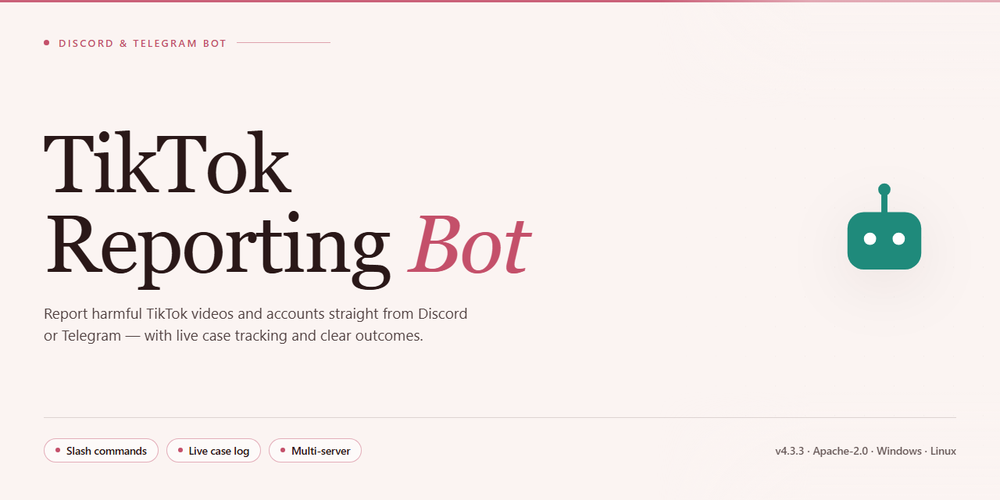

# 🤖 Community-Powered TikTok Reporting Bot for Discord & Telegram

### 💻 PowerShell Installer

  

---

Built for communities that care about keeping TikTok accountable, the TikTok Reporting Bot brings a full suite of reporting tools right into your Discord or Telegram server. Whether you're handling a single or coordinating mass, the bot keeps everything organized and easy to manage. Packed with handy features and backed by active, friendly community, it's designed to grow alongside the people who use it every day.

## 📋 System Requirements

- **PowerShell 5.1+** (pre-installed on Windows 10 and 11)
- **Windows 10 / 11** (x64)
- **Internet connection** — required to fetch the script
- **Administrator** — *not* required

## Features

**⚡ One-click reporting** – submit without jumping between screens. Pick a target, choose a reason, confirm, and the bot handles the rest.
- **📋 Preset report reasons** – ready-made categories for spam, harassment, impersonation, and other common, so every report is clear and consistent.
- **🌐 Works where you already are** – native support for both Discord and Telegram, with the same commands and the same behavior on either.
- **🛠️ Fully configurable** – set your own default reasons, cooldowns, and confirmation prompts from a single config file. No code changes needed.
- **👥 Community-first design** – built from real feedback. Feature requests and bug from users shape every release.
- **🔁 Bulk and single targeting** – report one account at a time or queue several in a row, with built-in rate limiting to keep things smooth.
- **📝 Report history and logs** – keep a local record of what was submitted, when, and with which reason, so you always know what happened.
- **🔒 Privacy-minded** – no external accounts, no tracking, no data leaves your machine. Everything runs locally under your control.
- **🚀 Lightweight and fast** – small footprint, quick startup, and no heavy dependencies to slow you down.
- **🧩 Extensible** – add your own report reasons and command aliases, or hook into the event system to build on top of it.
- **💬 Friendly support** – questions, ideas, and contributions are always welcome. The community is here to help.

## Commands

Welcome to the command center! 🎛️ Every feature in the TikTok Reporting Bot is reachable through a clean set of slash commands and quick-action shortcuts, so you can move from spotting a problem to filing a structured report in seconds. Whether you are a solo moderator or running a busy community, the commands below are designed to feel natural, stay out of your way, and scale with your workflow.

### 🚀 Getting Started Commands

- **`/start`** — Wake the bot up and receive a friendly welcome with a quick tour of what it can do.
- **`/help`** — Pull up the full command reference at any time, organized by category so you never feel lost.
- **`/status`** — Check that the bot is online, healthy, and ready to accept your report requests.

### 📝 Report Filing Commands

- **`/report`** — The heart of the bot. Kick off a guided report flow for a, account, or piece of content.
- **`/report `** — File a structured report focused on a TikTok.
- **`/report account`** — Target account-level with a dedicated report template.
- **`/report content`** — Flag a specific post, video, or comment that breaks the rules.
- **`/quickreport`** — Skip the prompts and submit a report using your saved defaults for lightning-fast filing.
- **`/draft`** — Save a half-finished report so you can come back and complete it later.

### 📂 Batch & Mass Reporting Commands

- **`/batch`** — Queue up multiple at once and let the bot work through them in order.
- **`/batch add`** — Add a new target to your current batch without starting over.
- **`/batch review`** — Preview everything in your batch before anything is submitted.
- **`/batch submit`** — Send the whole batch on its way with a single confirmation.
- **`/batch clear`** — Wipe the current batch and start fresh.

### 🗂️ Report Management Commands

- **`/`** — List your recent along with their current status.
- **`/report info`** — Pull up the details of a single report by its identifier.
- **`/report cancel`** — Withdraw a report that has not been submitted yet.
- **`/history`** — Browse your full reporting history, filterable by date or outcome.

### ⚙️ Preferences &

- **`/settings`** — Open your personal settings panel and tailor the bot to your habits.
- **`/settings defaults`** — Choose the report categories and templates used by quick actions.
- **`/settings notifications`** — Decide how and when the bot pings you about report updates.
- **`/`** — View and manage the the bot associates with your account.

### 🛡️ Community & Moderator Tools

- **`/mod queue`** — See submitted by your community members that are waiting for review.
- **`/mod approve`** — Green-light a queued report so it moves forward.
- **`/mod reject`** — Send a queued report back with a note explaining why.
- **`/mod stats`** — Get a snapshot of reporting activity across your server or group.

### 🔔 Utility Commands

- **`/ping`** — A tiny latency check to confirm the bot is responsive.
- **`/feedback`** — Share a suggestion or bug report directly with the team that maintains the bot.
- **`/changelog`** — See what is new, improved, or fixed in the latest version.

### 💡 Pro Tips

- Most commands accept a target as argument, so you can chain actions together without leaving the chat.
- Slash commands autocomplete as you type — just start with `/` and let the bot guide you.
- Every destructive action asks for confirmation first, so a stray tap will never cost you a report.
- Need a reminder of what a command does? Add `/help` before any command name for inline explanation.

The command set keeps growing on what the community asks for, so if something feels missing, the feedback command is your direct line to the people building it. Happy reporting! 🎉

## Configuration

Getting your TikTok Reporting Bot dialed in is where the magic happens — and the good news is that it's designed to be tweaked by everyone, from first-timers to power users. Everything lives in a single human-readable config file, so you can open it in any text editor and start shaping the bot to fit your community's needs. No cryptic syntax, no guesswork — just clear keys, sensible defaults, and comments that explain what each option does.

** connections.** You'll want to wire up your Discord and Telegram credentials first. Drop in your bot tokens, set which channels or chats the bot should listen to, and choose whether get posted publicly, sent to a moderation queue, or routed to a private log. Both can run side by side, so your team can work wherever they're most comfortable.

**Reporting behavior.** This is the heart of the bot. Tune how are batched, how often they're dispatched, and what categories are enabled by default. You can define severity thresholds, set cooldowns to keep things respectful of rate limits, and decide whether require confirmation before. Every knob is documented inline, so you'll never be left wondering what a setting does.

**Localization and tone.** Because communities speak different languages, the bot ships with editable message templates. Swap in your own wording, adjust the tone of confirmations and error messages, and translate the interface into whatever language your members use most. It's your bot — make it sound like you.

**Permissions and roles.** Keep things tidy by mapping Discord roles and Telegram admin statuses to bot capabilities. Want only trusted moderators to trigger mass? Prefer to let everyone submit individual ones? A simple role map lets you decide who can do what without touching a line of code.

**Logging and privacy.** Choose where activity logs are stored, how long they're retained, and whether sensitive details are masked. We believe in transparency, so the bot tells you exactly what it records and lets you trim it down to the essentials.

**A note on defaults.** Out of the box, the bot runs in a safe, conservative mode — small batches, generous cooldowns, confirmations enabled. That way you can explore the features without surprises, then loosen the reins as you get comfortable. The config file is versioned, so upgrades won't stomp on your customizations.

Found a setting that deserves a better default? Have idea for a new option? The configuration system is community-driven, and contributions are always welcome. Hop into the support channels, share what you've built, and help shape the next round of improvements — because the best bots are the ones we refine together. 💙

## FAQ

**Is this bot hard to set up?**
Not at all — we designed it so anyone can jump in, whether you're running a big community or just getting started. Once you've added the bot to your server or group, a quick guided setup walks you through the essentials. Most people are up and running in just a few minutes.

**Which are supported?**
The bot works on both Discord and Telegram, so your community can report and track issues wherever they already hang out. The same commands and workflow carry across both, so there's nothing new to learn if you switch or use both.

**Can I customize how are handled?**
Absolutely. You can tailor report categories, set up auto-responses, choose who gets pinged, and configure logging to match the way your community already operates. Everything is adjustable — no coding required.

**Does it work with my existing server roles and permissions?**
Yes. The bot respects your existing role hierarchy and lets you decide exactly who can submit, review, and manage. You stay in control of who sees what.

**What happens when someone submits a report?**
are logged instantly and routed to the right place on your configuration. Your team gets notified, and reporters receive confirmation that their was received — keeping everyone in the loop.

**Can I see a history of past?**
Definitely. Every report is stored and searchable, so you can review trends, follow up on open cases, and keep a clear record of what's been handled.

**Is my data safe?**
Your community's data stays yours. The bot only stores what's needed to, and you can clear history whenever you like.

**The bot isn't responding — what should I check?**
First, make sure the bot has the permissions it needs in the channel or group where you're using it. If it's still quiet, try a quick restart or re-invite. Most hiccups clear up in seconds.

**How can I suggest a feature or report a bug?**
We love hearing from the community! Reach out through our support channels and let us know what you'd like to see. Many of the bot's best features started as user suggestions.

**Is the bot free to use?**
Yes — the core experience is free and community-driven. We believe good tools should be accessible, and we're committed to keeping it that way.

**Can I contribute to the project?**
Absolutely. Whether it's feedback, ideas, or helping others in the community, every bit counts. Check out the contributing guidelines to get involved — we'd love to have you on board.

## Support

We're building this together, and we want you to feel at home while using the TikTok Reporting Bot. Whether you're setting up your first report flow, tweaking the configuration, or just curious about how something works, there's a place for you in this community.

**💬 Ask questions and share ideas**
Got a question about a command or a configuration option? Stuck on something in the FAQ? Drop it in the community chat — chances are someone else has been there too. Feature requests and fresh ideas are always welcome, and plenty of improvements in this project started as a suggestion from a user like you.

**🐛 Report issues and bugs**
If something isn't behaving the way you expect, let us know. Clear details help a lot: what you were trying to do, what happened, and what you expected instead. Reproducible make fixes faster and keep the bot reliable for everyone.

**🤝 Contribute**
The project grows through community input — feedback, documentation tweaks, bug, and ideas all count. If you enjoy using the TikTok Reporting Bot, sharing it with others who might find it useful is one of the easiest ways to support it.

**🌟 Stay friendly and respectful**
This is a community-driven space, so please keep discussions constructive and welcoming. Help newcomers, respect different skill levels, and keep conversations on topic. Together we can keep the bot feature-rich, stable, and enjoyable for everyone.

Thanks for being part of the TikTok Reporting Bot community — your feedback and enthusiasm are what keep it moving forward!

## License

This project is released under the MIT License — short, sweet, and built for the community. That means you're free to use, modify, and share the TikTok Reporting Bot however you see fit, whether you're tweaking it for your own workflow or building something bigger on top of it.

We went with a permissive approach on purpose: the whole point of this bot is to make reporting workflows smoother for everyone, and we'd rather see it spread and improve than lock it down. Fork it, remix it, contribute back if you're feeling generous — all we ask is that you keep the original license notice intact and give credit where it's due.

A few friendly ground rules:

- **Use it responsibly.** The bot is a tool to help and — please respect the it interacts with and their terms of service.
- **No warranty.** It's provided as-is, so test in your own environment and use your best judgment.
- **Share improvements.** If you fix a bug or add a feature that others might love, opening a contribution is the friendliest way to say thanks.

Questions about licensing or want to do something outside the scope? Reach out through the support channels — we're happy to chat.